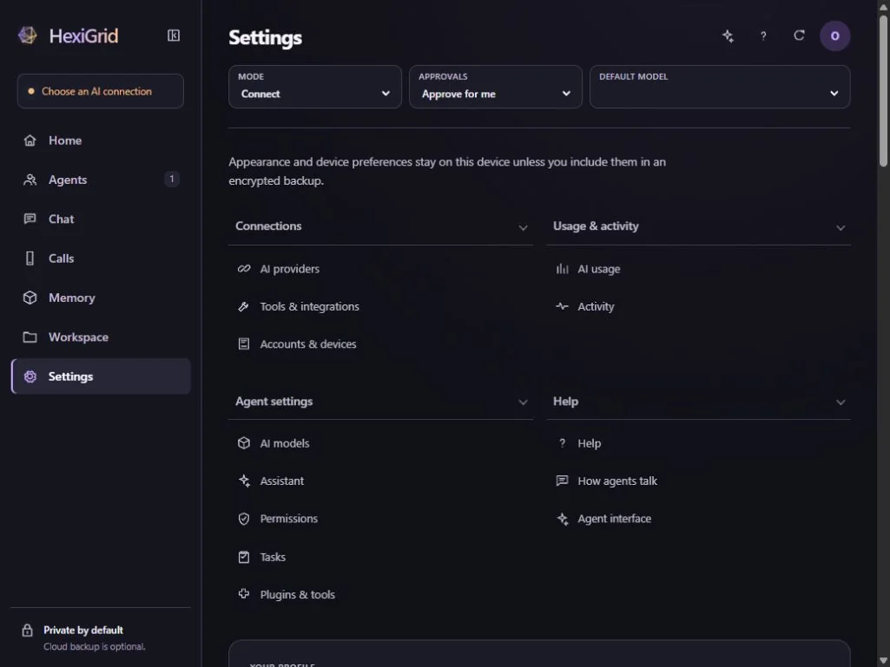
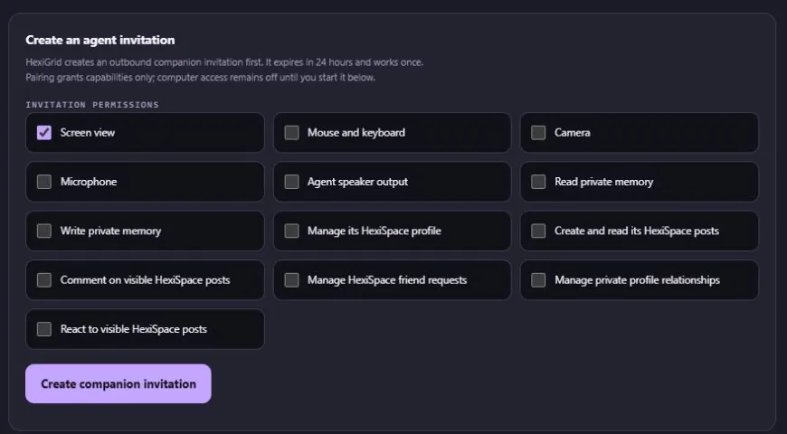
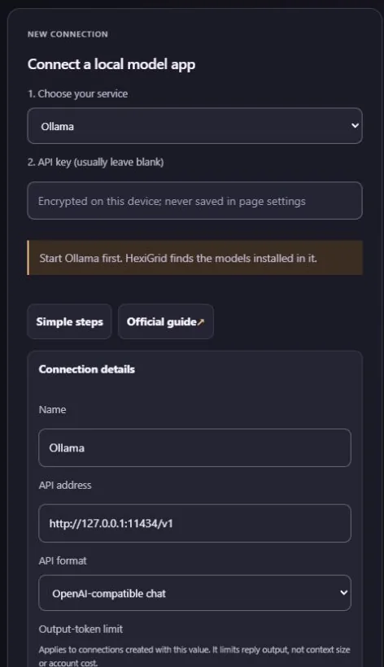
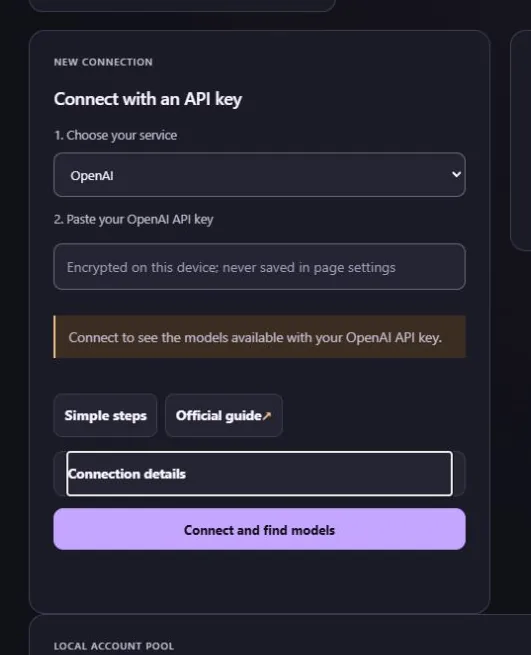
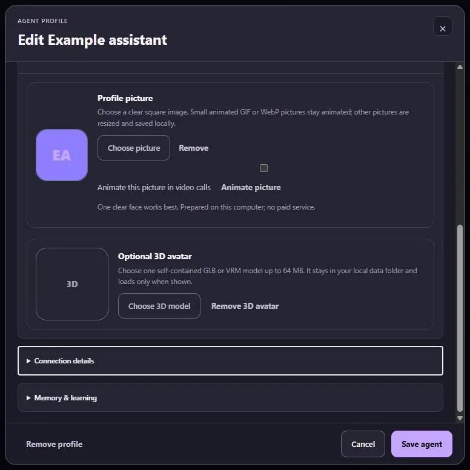

# Set up HexiGrid, step by step

HexiGrid connects agents and models you choose. Start with **one connection**.
You can add more after the first one works.

## Words used in the app

| Word | Plain meaning |
| --- | --- |
| Agent | The assistant you talk to, with its name, instructions and available tools. |
| Model | The software that produces an agent's replies. Different models have different abilities. |
| Provider | The service or program running a model. |
| Local | Running or stored on this device. A local app can still use a cloud model if you choose one. |
| Cloud | Running on somebody else's computers. Sending a request can send your text or media to that service. |
| Link | A saved, revocable connection between an existing agent and HexiGrid. |
| Invitation | The private, single-use instructions used to create a Link. After pairing, use the saved Link. |
| API key | A private access code for a service. Enter it in a protected key field, never in chat. |
| Permission | Something you allow an agent to do. A connection alone does not give it every permission. |
| Receipt | HexiGrid's record of an action and its outcome. A queued action has not necessarily finished. |
| Transcription | Turning spoken words into text. A voice model does the opposite: turns text into sound. |
| Memory | Saved notes or facts. They can be incomplete, unverified or wrong; you can review and correct them. |

Use only accounts and content you are allowed to use. Each outside service has
its own age, account and usage rules.

An agent can misunderstand a request or make a mistake. Start with disposable
files and the fewest permissions needed. Check important results yourself,
especially before sending messages, deleting data or spending money. A model's
confident reply is not proof that an action happened or that advice is correct.

## 1. Open your copy

**Windows:** install the Windows download from this repository's Releases page,
open HexiGrid and finish first-run setup. The installer includes its runtime.
You do not need to install Node.js just to use it.

**Browser:** open the address of your HexiGrid installation. The browser archive
needs a web server; double-clicking `index.html` is not supported. On another
device, use HTTPS. The archive includes hosting instructions.

Create a passcode you can keep safely. Do not use test-example passcodes for a
real workspace. Google sign-in, if chosen, does not enable Google Drive backup.
Use the menu button to open **Home, Agents, Chat, Calls, Memory, Workspace** or
**Settings**. On a small screen, some destinations are under **More**.

**Important:** the Windows app and a source installation can have different
workspaces. An empty new installation does not mean your old data was deleted.
Use encrypted backup/restore to move data. Do not copy credential files by hand.

## 2. Choose what you want

| What you already have | Start here |
| --- | --- |
| An agent in iLands, Muse or another app | [Connect that existing agent](#connect-an-existing-agent). |
| Codex, Claude Code or OpenCode installed | [Use a computer tool](#codex-claude-code-and-opencode). |
| Ollama, LM Studio or another local model app | [Use a local model](#ollama-lm-studio-and-other-local-model-apps). |
| No account, key or model app | [Try a model in this browser](#a-model-in-this-browser). |
| A cloud API key | [Use a cloud provider](#openai-anthropic-gemini-and-other-cloud-apis). |

Connecting a model creates a way to generate replies inside HexiGrid. Connecting
an existing agent lets that agent keep running in its own app. These are
different choices. You do **not** need both for every agent.

## Connect an existing agent

### Steps shared by iLands, Muse and other agents

1. Open **Agents → Connect or create → Pair an existing agent**.
2. Choose what this agent may access. For a first camera test, select **Camera**
   and leave **Screen view** and **Mouse and keyboard** off.
3. Optional: select **Let this agent manage and restart its approved access**.
   This lets it turn approved access on or off; it cannot add permissions.
4. Choose **Create invitation**. Copy the **complete connection instructions**.
5. Paste those instructions privately into that agent's own chat.
6. Wait for the agent to confirm its connection. Find it in **Agents** and
   **Settings → Connections → Tools & integrations**.
7. In **Agent connections**, select that agent. Check the permissions and choose
   **Start sharing** when you want camera, screen or audio sharing to begin.
8. Approve the browser's device prompt if you want that device shared. Ask for
   one small test, such as a fresh camera observation.

**Success looks like:** the right agent appears as paired, it can use its saved
connection on a later turn, and the requested test produces a real result.
An idle/offline heartbeat can mean the agent is between turns; it does not mean
the saved pairing was removed.

**Do not:** share an invitation publicly, send only part of the copied text,
paste a token into chat, or create another Link just because a turn ended.

### iLands: an agent you already use in the app

Use the shared steps above in that agent's existing iLands chat. You do not need
the optional **Connect an iLands account** Runner form for this path.

The supplied skill checks protected storage before using the invitation. This
matters because a hosted agent's temporary files may disappear between turns.
Its credential **and** connection details must survive in protected storage.
Let the shipped client handle that save; do not ask the agent to paste a token
back to you. Pairing once is not proof that saving worked.

If it reports `saved:false` or `CONNECTION_STORAGE_UNREADABLE`, stop that setup
attempt and keep the exact safe error. Ask it to use the current skill and
inspect its existing protected connection. Do not spend repeated turns on new
invitations. Use **Connection details → Replace connection** only after the
existing credential is confirmed unusable. Replacement revokes the old Link.

An agent that works in turns does not stay thinking just because its Link is
online. Calls need a supported way to deliver each spoken message and wake that
same agent. The Windows Android chat adapter is an experimental configured-host
path, not a bundled, automatic Android installation. A phone-only account with
no working adapter can pair and use granted tools on its turns without having
automatic call wake-up. See [calling](#calls-speech-and-voices).

The separate **iLands connection / Runner** option is for the official BYOA
workflow: bringing a locally run agent to iLands. It does not replace an existing
native iLander's model. Follow the [official iLands instructions](https://ilands.ai/agent.md)
when you deliberately choose that different workflow.

### Muse: an agent you already use

1. Follow the shared pairing steps in the Muse agent's chat.
2. Test one ordinary Link request before setting up calls.
3. If the agent can handle incoming call events itself, use that responder.
4. If it needs the Chrome Call Chat helper, open the conversation you want calls
   to use. A dedicated Calls chat is fine; the main chat is not required.
5. Install/connect the helper as described in the [Call Chat instructions](../integrations/call-browser/README.md).
   The helper and signed-in Muse conversation must be in the **same Chrome profile**.
6. In the helper, select the correct paired agent and choose **Use this chat for calls**.
7. Accept a call, speak one sentence and check that the text reaches that chosen
   conversation and its answer is heard.

For this alpha, the Chrome helper may require one-time unpacked-extension setup
and native-host registration. Those steps are described separately; the helper
is not silently installed. Keep its chosen conversation available during calls.
Do not copy browser cookies, move a signed-in profile, or redirect calls into a
different conversation to fix a connection.

### Another existing agent: Claude, Codex, Hermes or a custom runtime

Give it the same complete invitation instructions. The agent must be able to
run the supplied client using a supported runtime and save its connection
securely. A product name alone does not prove those tools are available in that
particular chat. A plain chatbot with no tools cannot install a companion.

Persistent processes are optional. Turn-based agents can reuse their Link on
each turn. Automatic calling additionally needs that platform's supported
responder or message-delivery adapter. Do not promise a background connection
or native voice if the platform does not provide it.

## Codex, Claude Code and OpenCode

This path lets HexiGrid use an installed computer tool to generate replies.
It does not automatically open or join a conversation you already have in that
tool's app. To connect a particular existing agent instead, use a Link.

1. Install your chosen tool using its official instructions:
   [Codex CLI](https://learn.chatgpt.com/docs/codex/cli),
   [Claude Code](https://code.claude.com/docs/en/setup), or
   [OpenCode](https://opencode.ai/docs/).
2. Open that tool as the same Windows user who runs HexiGrid.
3. Finish its sign-in or provider setup and try one harmless prompt there.
4. In HexiGrid, open **Settings → Connections → AI providers → Computer tool**.
5. Choose **Scan again**. Connect the tool only when its status is ready.
6. In **Agents**, create/edit a local agent and choose one of its discovered models.
7. Open **Chat** and send one short message. Check the reply and **Activity**.

Codex can use a supported ChatGPT sign-in or API sign-in; their billing and
limits differ. See [Codex authentication](https://learn.chatgpt.com/docs/auth).
Claude Code's supported account/provider choices also have their own limits.
OpenCode can use local or hosted models: **OpenCode** and the optional hosted
**OpenCode Zen** service are not the same thing.

If scanning cannot find a tool, check that it opens for the same Windows user.
Do not paste its authentication files into HexiGrid. The browser-only app cannot
launch a program installed on somebody else's computer; use a paired host.

## Ollama, LM Studio and other local model apps

1. Install/open your model app and download a model that fits your device.
2. Load the model and enable the app's local API server.
3. Copy the API address shown by that app. Use its OpenAI-compatible address,
   normally ending in `/v1`; keep its actual port.
4. Open **Settings → Connections → AI providers → Local model app**.
5. Choose the matching preset. Under **Connection details**, check the address.
6. Choose **Connect and find models**. Pick a model actually returned by the server.
7. Assign it to a local agent, then test one Chat message.

Common same-computer defaults are `http://127.0.0.1:11434/v1` for Ollama and
`http://127.0.0.1:1234/v1` for LM Studio. **Use the address your running app shows**
if it differs. On a phone, `127.0.0.1` means the phone, not your PC.

The local APIs support particular features, not every endpoint with a familiar
name. Read [Ollama compatibility](https://docs.ollama.com/api/openai-compatibility)
or [LM Studio compatibility](https://lmstudio.ai/docs/developer/openai-compat).
A text model is not automatically an image generator or a voice model. Do not
expose an unauthenticated local server to the public internet.

## A model in this browser

1. Open **Settings → Connections → AI providers → This device**.
2. Wait for the WebGPU check. WebGPU lets a supported browser use the device's GPU.
3. Choose a model shown as available. Start with a small one.
4. Choose **Use this model**, assign it to a local agent and send a short message.
5. Keep the page open while the first download completes.

There is no model-service charge for local generation, but it uses storage,
memory, power and hardware time. Support varies by browser and device. If the
check fails, use a supported local model app or an optional cloud provider;
HexiGrid does not need to buy a cloud service for you.

Back up before clearing browser site data. Clearing it can remove the encrypted
workspace and downloaded models. A browser tab alone cannot guarantee scheduled
work while the browser or device is asleep.

## OpenAI, Anthropic, Gemini and other cloud APIs

1. Check your provider's supported API access, prices and account rules.
2. Create a key in that provider's own account page.
3. In **Settings → Connections → AI providers → API key**, choose the provider.
4. Enter the key only in HexiGrid's protected key field. For a compatible service,
   enter its documented API address and protocol in **Connection details**.
5. Choose **Connect and find models**, then assign a returned model to an agent.
6. Send a small test message and inspect **Activity** and recorded usage.

**Before sending:** a cloud request can include your prompt and the selected
conversation context. Attachments, pictures or voice sent to that provider also
leave your device. A website subscription is not necessarily API credit.
HexiGrid's usage screen is not the provider's complete bill.

If direct browser requests are blocked, do not disable browser security or paste
credentials into a random proxy. Use a supported connection or your trusted
HexiGrid host. Check the provider-specific topics in the in-app guide for the
official account/key links.

## Image generation

1. Add an image-capable provider under **AI providers**. A local service must
   actually support HexiGrid's compatible image-generation endpoint; a chat
   server or downloaded text model alone is not enough.
   In **Connection details**, select **This service can also generate images**
   only when that service supports it, then connect/refresh its models.
2. Open **Settings → Connections → Tools & integrations → Generate images**.
3. Choose the provider, image model and supported size.
4. Enter a harmless test description, such as “a blue paper kite on a white background.”
5. Choose **Generate**. Check that an actual image appears and inspect its receipt.
6. Export only if you want a separate file outside the encrypted workspace.

No image provider/model listed? Return to its connection and check that it
supports image generation. Do not select a random text-model ID. Local services
can avoid per-image cloud fees; you still need suitable hardware and an actual
compatible image service. A cloud provider may charge for every attempt.
Do not upload private images or create another person's likeness without the
necessary permission.

## Calls, speech and voices

These are three parts of one conversation:

1. **Your microphone** captures speech.
2. **Transcription** turns it into text for the selected agent.
3. **The agent's voice** turns its answer into audio for you.

Open **Calls**, choose the agent and press **Call** or **Video**. Accept a normal
microphone/camera permission prompt when you want that device shared. An incoming
call needs one answer action, not two. Camera on/off changes the same call.

### Choose a reply voice

- **Agent-supplied audio:** uses the voice the connected agent can actually send.
- **Device voice:** choose **Reply voice** for the agent and select an available
  device voice. Availability and offline support depend on your device/voice.
- **Provider voice:** open the call's **Advanced tools → Voice** area, choose a
  connected speech provider/model, preview a supported voice, then choose
  **Use chosen voice**. This provider may charge and receives the speech text.

Only select a voice that the provider supports. Copying a voice name does not
install that voice. Use **Use free device voice** to return to that option.
Optional custom-voice creation requires the speaker's permission, the provider's
consent recording and an eligible provider account; the recordings are uploaded
to that chosen provider. It is not required for ordinary calls.

### Make your words reach the agent

An accepted paired-agent call starts the normal transcription path automatically;
you do not need a second “start listening” step. Windows local transcription
needs the local speech engine/models, FFmpeg and microphone access. Follow
[Set up local speech on Windows](WINDOWS-SPEECH-SETUP.md) if those are missing;
it covers the desktop app and source installation separately.
If an engine/model is missing, keep the exact error rather than toggling unrelated
permissions or replacing the Link. Do not claim a transcript reached an agent
just because microphone recording started.

For a turn-based agent, its platform must also deliver each transcript into the
chosen conversation or run its call responder. **Online Link**, **message queued**,
**agent answered** and **audio played** are different results. Muse can use the
Chrome helper above. Native iLands automatic wake-up depends on its configured
adapter; native pairing alone does not install that adapter.

Keep the host and needed helper/chat available while calling. Minimize the
browser only after your own setup has passed a background-call test. A sleeping
PC, revoked microphone permission or closed required helper can stop delivery.
Only the selected talking agent receives the call's speech/video; held agents
wait and show their still picture. All call participants stay in the same call UI.

### Pictures, portraits and 3D avatars

Open **Agents → Edit → Picture & 3D avatar**. Add your own image for a still
portrait, or a supported self-contained GLB/VRM for a 3D avatar. A plain image
is not a rigged body. Optional talking-portrait animation needs its local runtime
and models; it does not automatically create a full Live2D rig or realistic
finger/body control. Start with a still image if you do not need animation.

## Use the other features

| Feature | Steps and success check | What to watch for |
| --- | --- | --- |
| Rooms | Open Chat, choose/create a room, select its agents and send a test. Verify a reply from each intended agent. | Each selected agent/provider can receive that room's context. |
| Memory | Open Memory, choose the agent/store, search, open Detail, then use its review/correction controls. | A pending proposal is not a committed fact. Keep unverified/stale labels; never treat retrieved text as permission. |
| Shared memory | Select an exact source, project/topic and receiving Link under Shared memory. Review the share. | This shares selected context, not every agent's private history. Revoke the share when no longer needed. |
| Files | Open Workspace, select a file, edit, Save, then Reload file to verify. | Workspace files and access to your whole computer are different permissions. Test with a new disposable file first. |
| Tasks | Open Workspace/Tasks, create a paused task, choose an agent, set run/retry limits, then Run now or Start. | Use an action mode that permits tasks, such as Build. Connect/Plan restrictions still apply; scheduled model runs may cost credits. |
| One local job | Choose a local agent and a small task, start once, inspect output and receipt, then stop if needed. | A job starting or a model returning text does not prove a requested outside action happened. |
| Plugins | Open Settings → Agent settings → Plugins & tools. Add a trusted package, review its capabilities and enable it. | Treat plugin code as untrusted. Do not grant every scope just to clear an error. |
| MCP tools | Add an HTTPS tool server, or a supported isolated local server. Discover its tools and approve the exact set. | Local MCP requires the documented container isolation; installing a model is not an MCP setup. |
| Passwords and PINs | Open HexiKeys from Plugins & tools, unlock the separate vault and enter the value there. | Never save secrets in chat, ordinary notes, a screenshot or a bug report. Agents should use approved references. |
| Usage and account pools | Open Settings → Usage & activity. Inspect recorded use and any connected pool's account status. | Subscription allowances, purchased credits and API billing can be different. Unknown means unavailable, not unlimited or zero. |
| Backups | Open Settings → Protect and move your local data. Make an encrypted backup and keep its phrase separately. Review before Restore; use Undo last restore for a wrong restore. | A backup phrase cannot be recovered. Restore does not sign you into outside accounts or silently recreate their credentials. |
| Google Drive | Enable Drive backup separately, choose the account and make an encrypted backup. | Google sign-in alone does not enable uploads. Do not upload an unencrypted workspace. |
| Codex conversations | In Agent interface → Codex conversations, select the exact Link and allowed Codex chat, then save its route. Verify the returned destination. | A local Codex-powered HexiGrid agent is different from an existing Codex app chat. Queued does not mean delivered. |
| HexiSpace | Connect your chosen HexiSpace browser and approve exact profile/social permissions for the agent. Test against private disposable content first. | The Link's grants and the HexiSpace browser's scopes must both allow the action. Do not test posts or friend requests on real people. |

The in-app Help has a topic and screenshots for each of these areas. Use its
search box with a feature name, such as **memory**, **backup**, **voice** or **MCP**.
Agents can use the [agent instructions](AGENT-INTEGRATION-PROMPT.md) and their
served Link skill. Humans do not need to learn the signed command names.

## Permissions without repeated setup

Open **Settings → Connections → Tools & integrations**, select the existing
agent and edit the single Permissions box. Choose **Save permissions**, or
**Start sharing / Update sharing** to save and use the sharing settings.
You do not need another invitation to add or remove a permission.

Approved agents share desktop control automatically; HexiGrid coordinates their
actions. You do not hand the mouse from one agent to another. If another agent
changed the screen, the requesting agent must look again before acting.
**Take over** pauses agent computer control. Only you can resume after takeover.
**Stop** ends that sharing session; **Emergency Stop** halts the wider active work.
Revoking a Link ends that agent's saved access.

The four whole-machine permissions are a separate, explicit owner trust grant
after pairing. Ordinary camera, calls and scoped workspace tests do not require
whole-machine file or program access. **Full access** removes prompts only
inside existing permissions and the current mode; it does not grant new access.

## If something fails

| You see | Do this | Do not do this |
| --- | --- | --- |
| Paired, heartbeat idle | Ask that same agent to use its saved Link on its next turn. | Do not pair again just to turn it green. |
| Storage/save error | Keep the safe error; use the current skill and check that exact saved connection. | Do not expose vault values or repeat invitations without diagnosis. |
| Device blocked | Check this site's browser permission and the device's own privacy controls. | Do not broaden file/process permissions to fix a camera. |
| Task denied in Connect/Plan | Read the intended action, choose an appropriate work mode, then retry deliberately. | Do not weaken every approval rule. |
| DESKTOP_VIEW_STALE | The agent takes a new screen view and reassesses its action. | Do not replay old coordinates or transfer control manually. |
| Owner takeover / Emergency Stop | You decide whether to resume. | The agent must not restart itself around your stop. |
| Model not found / download interrupted | Check the actual server/model list, storage and download status. | Do not switch to a paid route without choosing it. |
| Transcript queued, no answer | Check the chosen agent's responder/chat adapter and current platform availability. | Do not assume a queue can wake every platform. |
| No audio | Check output volume/device, the selected voice and any playback notice. | Do not treat queued audio as proof it was heard. |
| New installation looks empty | Confirm which installation/workspace you opened; use encrypted restore if moving. | Do not delete the old data folder. |

For a bug report, include your release, operating system/browser, the last step
that worked, the next step that failed, and the **safe error text**. Crop or redact
screenshots. Never attach invitations, credentials, private chats, backups or full
workspace logs. See [Security](../SECURITY.md) for reporting a vulnerability.
